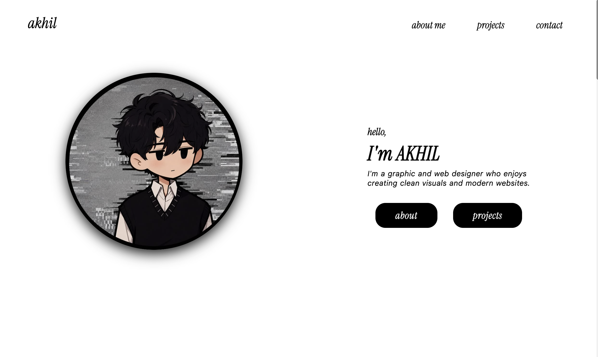
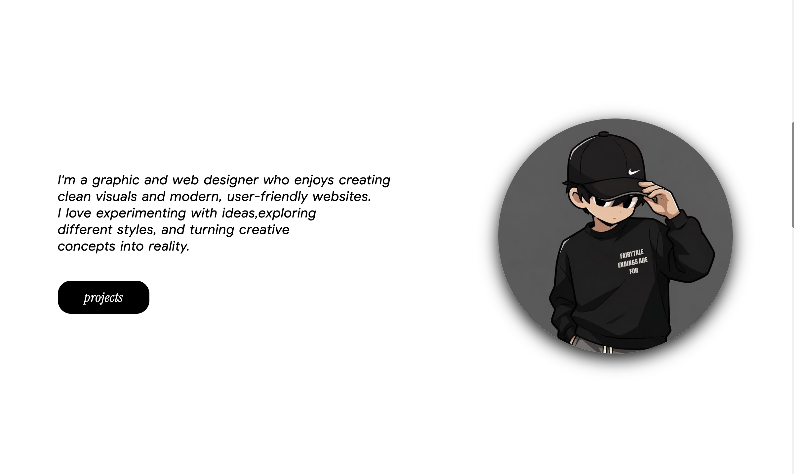
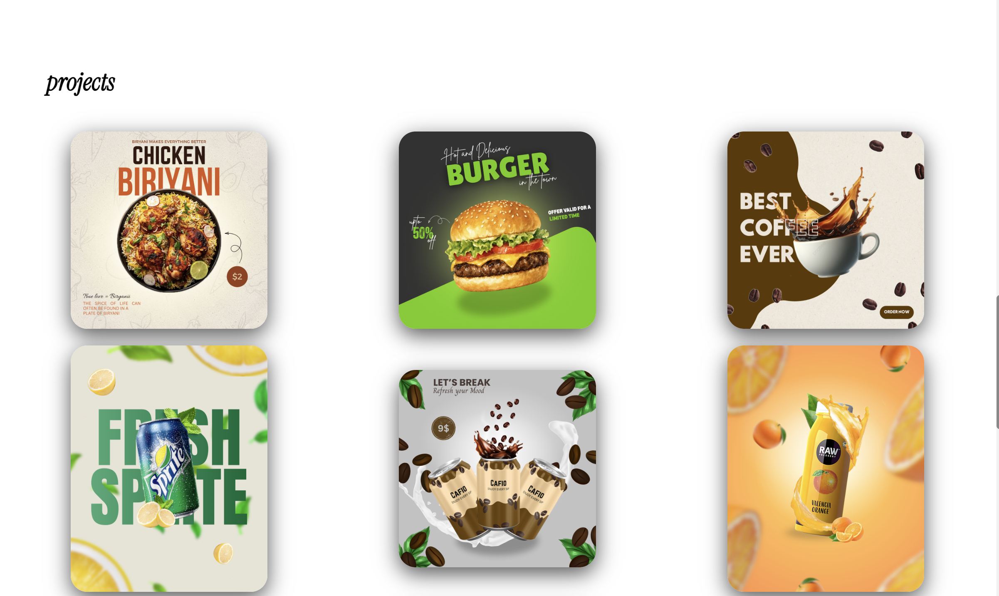
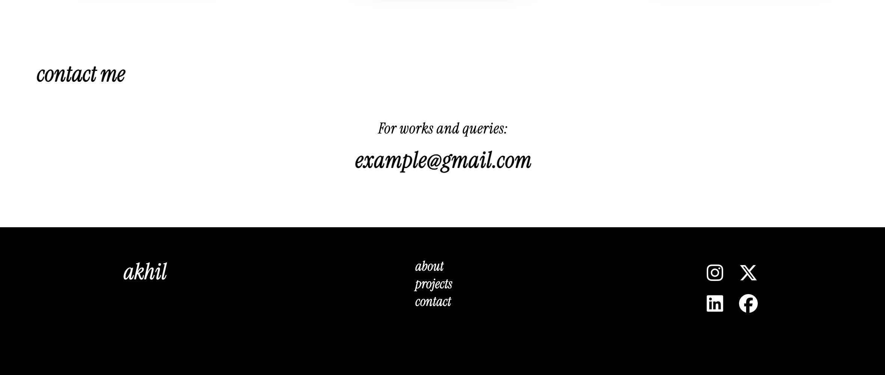

# ProjectX

**Second Version of my Portfolio**

This is my personal portfolio website, mainly made to showcase my graphic design works. Designing is something I enjoy doing the most, so I wanted to make a simple website where I can show my works.I tried to keep the design clean and simple without adding too many things. This is a new version, a new experiment to make a minimalistic website and I absolutely loved the way it turned out.

## Technologies Used

- HTML
- CSS

# Sections

- Home Page

- About Section

- Project Section

- Contact Section

## Features

- Smooth scrolling
- Simple navigation between sections
- My graphic design works
- Social media links

## NOTE:

The social media icons currently take you to respective platforms and not to my personal accounts. Maybe I will connect my actual accounts in the future.

Since this is a public repository, I have used a dummy email address as an example instead of my personal email.

**AKHIL**
